# Visual Casebook — 16 exemplos originais

**São 12 candidatos e 4 antiexemplos intencionais.** Cada ficha contém quando usar, por que funciona e quando rejeitar. Não são modelos aprovados para uso automático. Não há slides externos copiados.

### O 45S5 está mais próximo da rigidez do osso

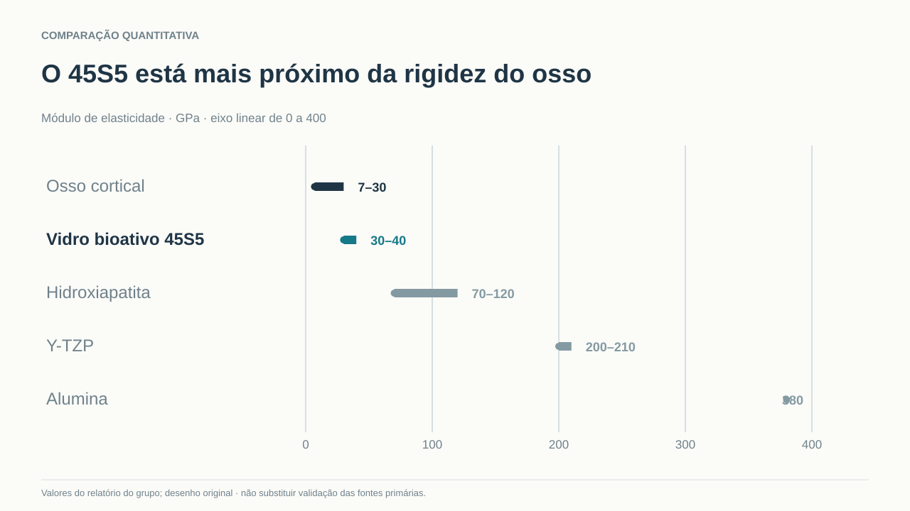

- **Ontologia:** `magnitude` · **Relação:** `intervals`
- **Use:** Medições comparáveis, valores com unidades e fontes, faixa comum.
- **Rejeite:** Séries com ordens de grandeza diferentes sem a discussão sobre escala.
- **Racional:** Cada material ocupa a posição do seu módulo, sem barras de categoria genéricas.
- **Fonte:** projects/biocer-materiais/data/propriedades.csv

### O vidro bioativo cria uma interface de apatita

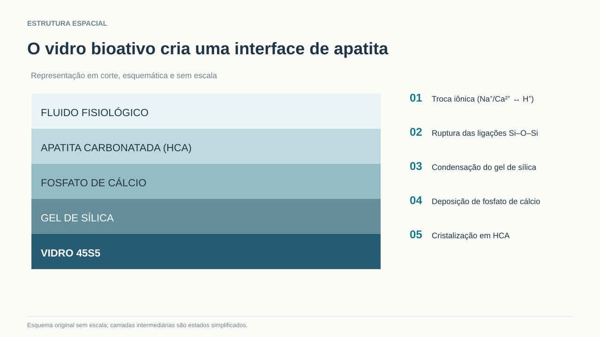

- **Ontologia:** `spatial_structure` · **Relação:** `layers`
- **Use:** A localização de camadas é essencial ao argumento.
- **Rejeite:** Quando as camadas representarem cronologia mas não coexistência; não sugerir espessura real.
- **Racional:** Mostra substrato, interface e fluido numa topologia espacial, não cinco caixas soltas.
- **Fonte:** projects/biocer-materiais/source/relatorio.md §4.5

### A transformação dos grãos dificulta o avanço da trinca

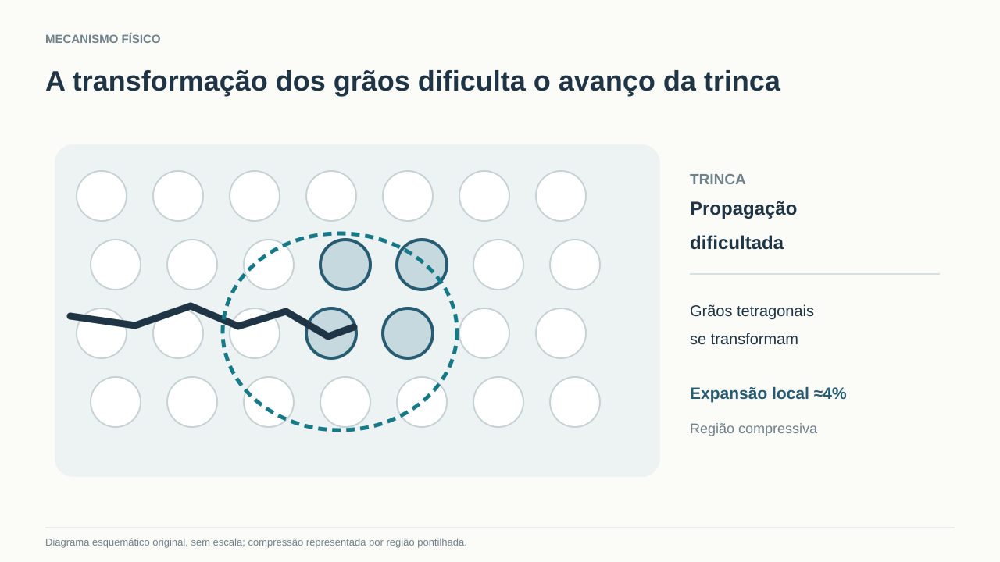

- **Ontologia:** `physical_mechanism` · **Relação:** `crack_transformation`
- **Use:** A interação espacial de grãos, trinca e tensão é central.
- **Rejeite:** Precisão geométrica indevida, apresentar círculos como imagem microscópica real.
- **Racional:** Relação causal está desenhada diretamente na região ativa.
- **Fonte:** projects/biocer-materiais/source/relatorio.md §4.2

### A mudança de fase altera o campo de tensões

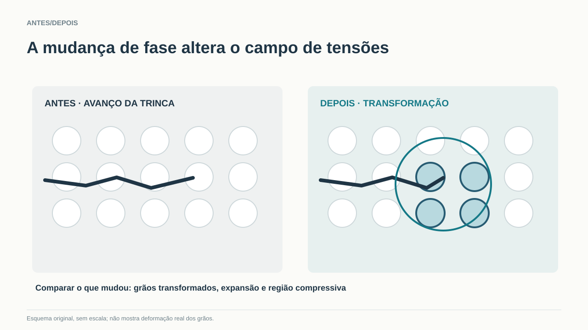

- **Ontologia:** `state_transition` · **Relação:** `state_comparison`
- **Use:** A audiência precisa reconhecer o mesmo objeto em dois estados.
- **Rejeite:** Quando antes/depois representa só uma linha temporal sem alteração representável.
- **Racional:** Contraste mantém objeto fixo e evidencia mudança física.
- **Fonte:** projects/biocer-materiais/source/relatorio.md §4.2

### Y-TZP supera alumina em flexão e tenacidade

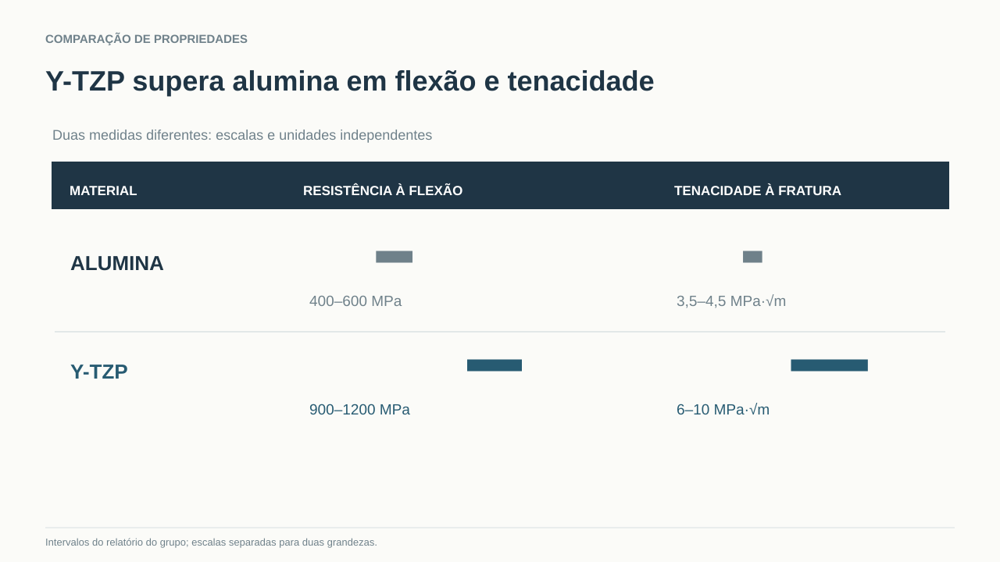

- **Ontologia:** `magnitude` · **Relação:** `parallel_scales`
- **Use:** Argumento compara dois materiais por duas medidas distintas.
- **Rejeite:** Não colocar propriedades com unidades diferentes em um mesmo eixo.
- **Racional:** Duas escalas alinhadas permitem diferenças sem misturar unidades.
- **Fonte:** projects/biocer-materiais/data/propriedades.csv

### Decisões locais podem amplificar a variabilidade

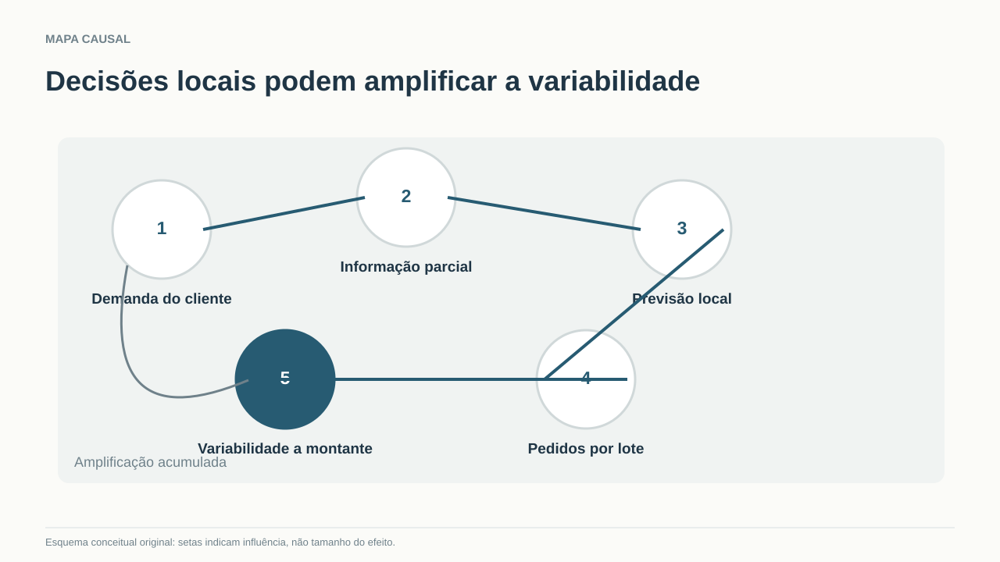

- **Ontologia:** `causal_feedback` · **Relação:** `causal_chain`
- **Use:** Variáveis conectadas por mecanismos plausíveis, não por proximidade no texto.
- **Rejeite:** Quando causalidade é hipótese e não há sustentação dos conectores.
- **Racional:** Setas têm semântica causal e permitem falar de pontos de intervenção.
- **Fonte:** conceitual — efeito chicote, sem magnitude empírica

### O custo total depende de volume e custo unitário

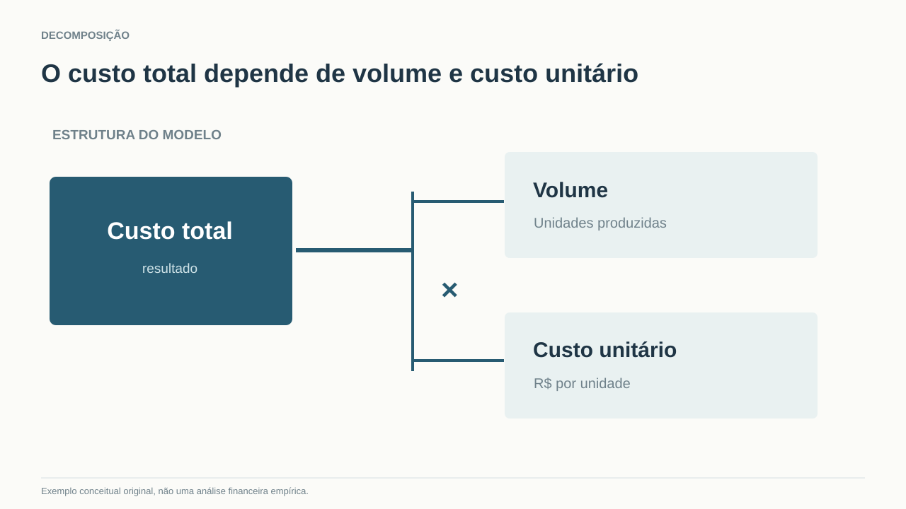

- **Ontologia:** `decomposition` · **Relação:** `multiplicative`
- **Use:** Relação matemática real entre resultado e seus determinantes.
- **Rejeite:** Não usar árvore de drivers para uma enumeração sem relação quantitativa.
- **Racional:** A conexão explicita a operação multiplicativa, sem cards independentes.
- **Fonte:** identidade matemática genérica

### O QA precisa validar design e conteúdo antes da publicação

- **Ontologia:** `sequence` · **Relação:** `swimlane`
- **Use:** As tarefas pertencem a fluxos distintos e têm gates.
- **Rejeite:** Setas decorativas em itens independentes.
- **Racional:** Separação por responsabilidades e etapas, com conteúdo em escala de leitura.
- **Fonte:** Slide Director, proposta de processo

### O processo e a microestrutura atuam sobre a resistência

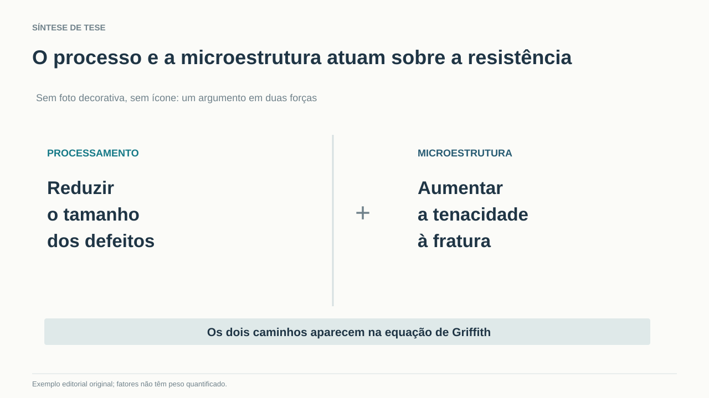

- **Ontologia:** `decomposition` · **Relação:** `two_levers`
- **Use:** Dois mecanismos distintos sustentam conclusão única.
- **Rejeite:** Tratar os dois fatores como equivalentes quantitativamente sem dados.
- **Racional:** Tipografia e divisão espacial sustentam argumento sem cards superficiais.
- **Fonte:** projects/biocer-materiais/source/relatorio.md §5.2

### A fonte é um gate antes de escolher o visual

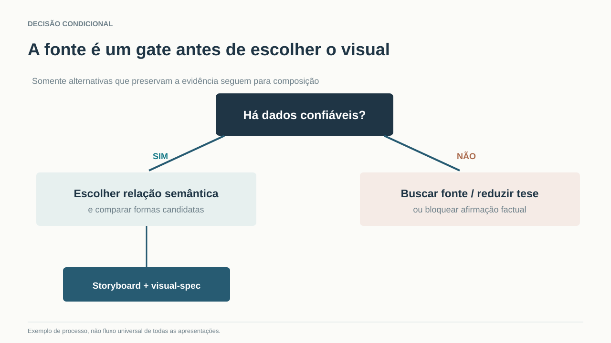

- **Ontologia:** `conditional_decision` · **Relação:** `branching`
- **Use:** A decisão depende de condição verificável.
- **Rejeite:** Não transformar fluxo linear num rombo de decisões artificiais.
- **Racional:** Branches rotulados mudam a ação; registro de alternativa rejeitada fica explícito.
- **Fonte:** Slide Director, regra proposta

### O revestimento de HA liga o osso à haste metálica

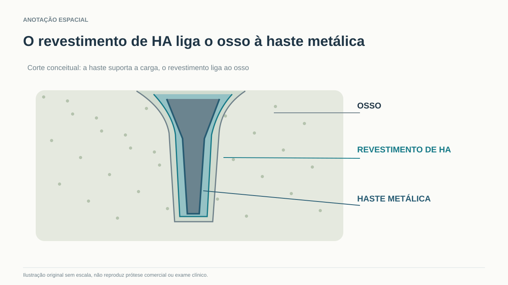

- **Ontologia:** `spatial_structure` · **Relação:** `material_interface`
- **Use:** Partes físicas distintas realizam funções complementares.
- **Rejeite:** Quando não existe geometria ou espessura confiável, indicar esquema sem escala.
- **Racional:** Funções são ancoradas em lugares físicos da prótese, não em três cartões.
- **Fonte:** projects/biocer-materiais/source/relatorio.md §7.1

### O estoque da Macy's cobre mais semanas de operação

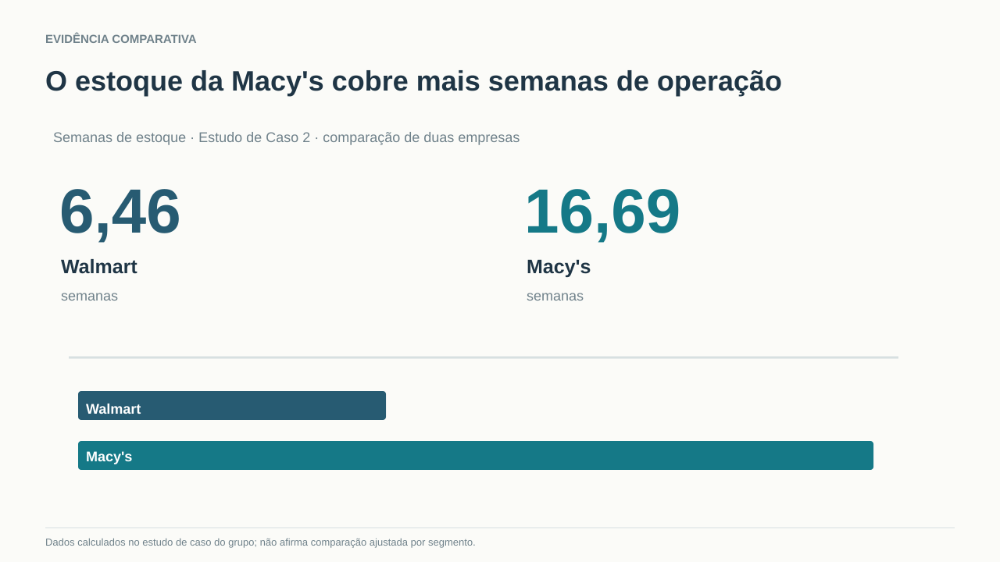

- **Ontologia:** `magnitude` · **Relação:** `bars_with_callout`
- **Use:** A diferença em uma métrica é a mensagem central do slide.
- **Rejeite:** Concluir causalidade da diferença sem contexto setorial.
- **Racional:** Valores e barras compartilham unidade e base comum, sem quadro decorativo.
- **Fonte:** projects/logistica-efeito-chicote/data/ec2-indicadores-walmart-macys.csv

### ⚠️ ANTI — Trinca, grãos e expansão como cards sem microestrutura

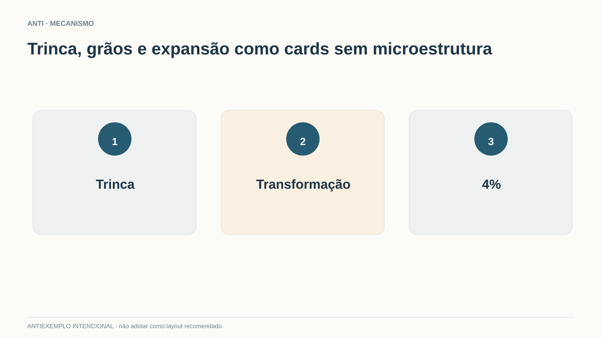

- **Ontologia:** `physical_mechanism` · **Relação:** `generic_steps`
- **Use:** Nunca como prova de mecanismo físico.
- **Rejeite:** Qualquer slide cujo título prometa interação material real.
- **Racional:** Círculos numerados não mostram localização, transformação nem impedimento da trinca.
- **Fonte:** original-illustrative

### ⚠️ ANTI — Quatro cartões genéricos substituem as evidências

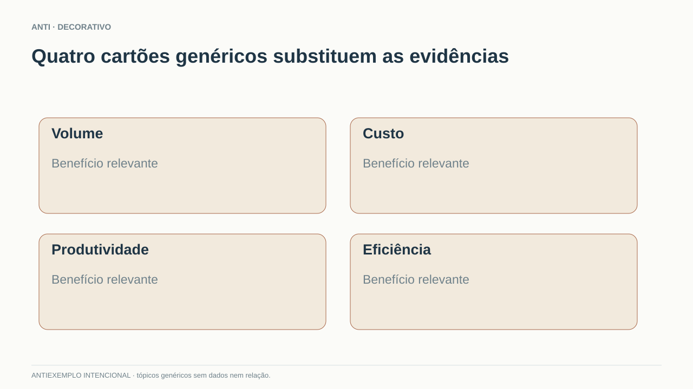

- **Ontologia:** `decomposition` · **Relação:** `independent_cards`
- **Use:** Não usar para justificar resultado sem relação entre os componentes.
- **Rejeite:** Quando o título exige decomposição causal ou quantitativa.
- **Racional:** Bordas e blocos organizam texto mas não codificam relação alguma.
- **Fonte:** original-illustrative

### ⚠️ ANTI — A mesma cor assume dois significados incompatíveis

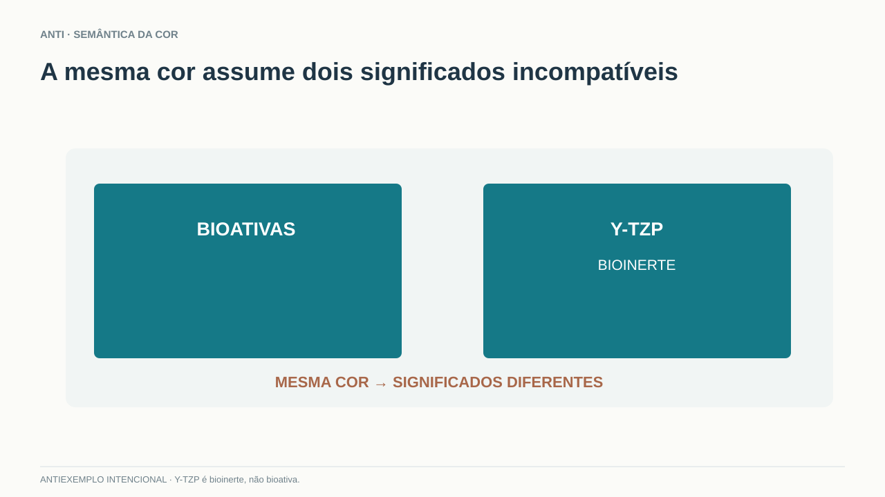

- **Ontologia:** `semantic_color` · **Relação:** `inconsistent_encoding`
- **Use:** Nunca usar cor de classe como destaque de outro significado sem explicação.
- **Rejeite:** Aplicação em decks com categorias cromáticas.
- **Racional:** Uma categoria previamente codificada se torna ambígua.
- **Fonte:** original-illustrative

### ⚠️ ANTI — Barras com alturas arbitrárias não constituem evidência

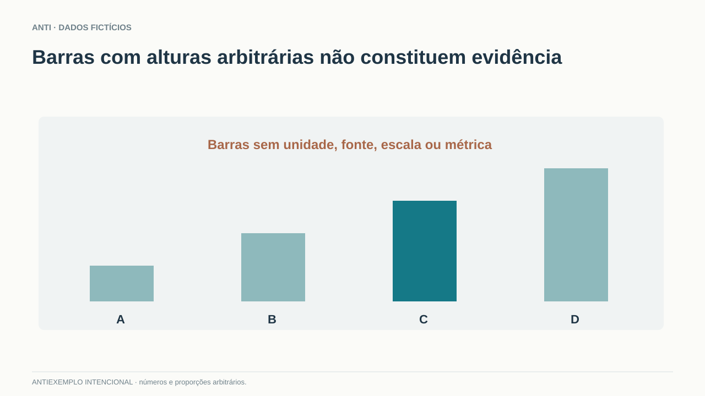

- **Ontologia:** `magnitude` · **Relação:** `unsupported_bars`
- **Use:** Nunca como suporte factual.
- **Rejeite:** Qualquer apresentação com conclusões numéricas.
- **Racional:** Altura de barra sem unidade e origem pode induzir inferência falsa.
- **Fonte:** original-illustrative
